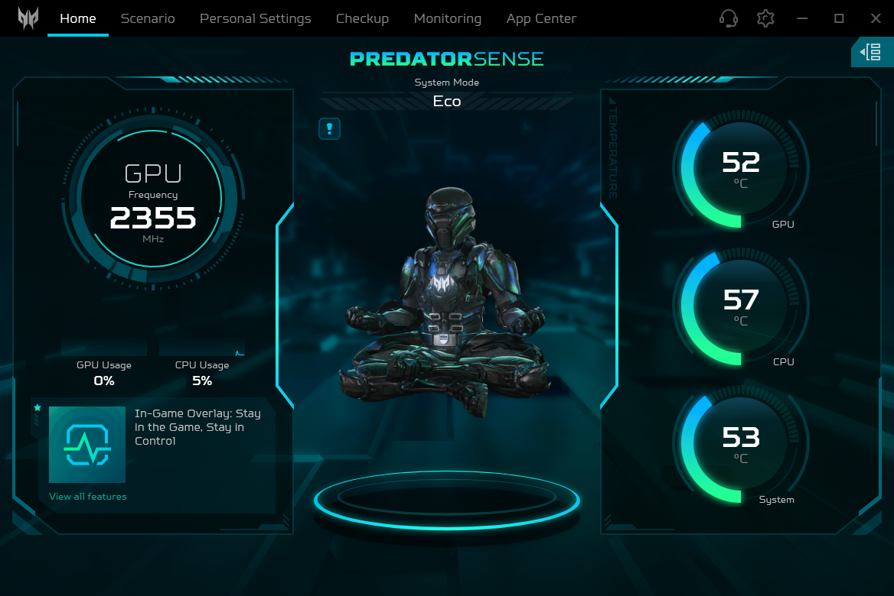

# Predator Sense Linux

[](LICENSE)
[](https://kernel.org)
[](#installation)
[](#100-offline--zero-telemetry-privacy-guarantee)
[](#security--privilege-model)

High-performance, complete native Linux control center for **Acer Predator & Nitro gaming laptops**.

Predator Sense Linux brings full hardware telemetry, thermal mode switching, advanced fan curves, 4-zone and per-key RGB lighting animations, battery care thresholds, and AI audio noise suppression to Linux—mirroring and expanding upon the official OEM Windows suite while remaining **100% offline and free of proprietary telemetry**.



---

## Table of Contents

- [Key Features](#key-features)
- [Supported Hardware](#supported-hardware)
- [System Architecture](#system-architecture)
- [Security & Privilege Model](#security--privilege-model)
- [Installation](#installation)
  - [Route 1: Fedora / RHEL (RPM Package - Recommended)](#route-1-fedora--rhel-rpm-package---recommended)
  - [Route 2: Universal Tarball & Installer (`install.sh`)](#route-2-universal-tarball--installer-installsh)
  - [Route 3: Arch Linux](#route-3-arch-linux)
- [CLI Reference (`psense`)](#cli-reference-psense)
- [Graphical Interface & System Integration](#graphical-interface--system-integration)
- [Honest Limits & Technical Details](#honest-limits--technical-details)
- [Contributing](#contributing)
- [License](#license)

---

## Key Features

### Thermal & Performance Profiles
- **Instant Mode Switching**: Switch on-the-fly between **Eco**, **Quiet**, **Balanced**, **Performance**, and **Turbo** modes.
- **Hardware ACPI WMI Integration**: Dispatches native vendor method calls to the Embedded Controller (EC) and aligns with kernel `platform-profile`.
- **Physical Mode-Key Synchronization**: Hardware turbo switch button dynamically cycles modes or activates one-touch Turbo with desktop notifications.

### Pulsar Dynamic Lighting Engine
- **Full RGB Suite**: Userspace frame-interpolation engine supporting **Breathing**, **Wave**, **Shifting**, **Meteor**, **Twinkling**, and **Static** color modes.
- **Screen Mimic (Ambilight)**: Real-time screen sampling that projects edge display colors directly onto keyboard backlight zones for immersive gaming.
- **Music & Audio Visualizer**: Live PipeWire audio spectrum analysis driving dynamic lighting intensity and frequency pulse effects.
- **Hardware Safe**: Eliminates firmware lockouts and keyboard blackouts by pacing updates across zones with smooth software-interpolated transitions.

### Advanced Fan & Cooling Control
- **Triple Fan Monitoring**: Real-time RPM tracking for CPU, GPU, and Auxiliary cooling fans via ACPI WMI and hwmon interfaces.
- **Fan Modes**: One-click **Auto**, **Max**, and **Custom Speed** controls (0–100% or absolute RPM).
- **Userspace Temperature Curves**: Custom temperature-to-PWM fan curves with configurable hysteresis, preventing constant fan ramp-up noise during burst workloads.

### AI Zone & System Enhancements
- **AI Smart Battery Care**: Enforces battery longevity thresholds (stops charging at 80% capacity) directly at the EC level, preserving battery health when connected to AC power.
- **Acer PurifiedVoice 2.0**: Linux neural AI noise cancellation integrating directly with PipeWire to filter out keystrokes, fan hum, and ambient room noise from your microphone.
- **PurifiedView Quick Access**: Direct integration for camera studio lighting, eye contact framing, and background blur under Linux.
- **Power-off USB Charging**: Toggle and configure charging thresholds for external devices via laptop USB ports while the system is powered down.

### Real-Time Hardware Diagnostics (`psense checkup`)
- **Battery Health & Wear**: Inspect design capacity, current full charge capacity, wear percentage, cycle count, and charging rate.
- **NVMe SMART Diagnostics**: Live controller health, temperature, and wear monitoring via `smartctl`.
- **System Memory Inspection**: Real-time DDR4/DDR5 clock speed, memory channel status, and RAM utilization via SMBIOS.

### In-Game Floating HUD & Desktop Integration
- **Compact Mini-Widget**: Translucent floating HUD overlay displaying live CPU/GPU temperatures, utilization, fan RPM, and active thermal profile.
- **System Tray Companion**: Background tray icon with quick mode switching, fan override presets, and battery health indicators.
- **Desktop OSD Notifications**: Non-intrusive notifications when changing thermal profiles via keyboard shortcuts or hotkeys.
- **App & Game Auto-Switching**: Automatically binds specific games or high-performance processes to Performance or Turbo profiles upon launch.

### 100% Offline & Zero Telemetry Privacy Guarantee
- **No Cloud Dependencies**: Acer account login dialogues and warranty registration prompts are neutralized in favor of a clean, local-only offline mode.
- **Hardened Network Firewall**: Bundled Electron runtime intercepts and hard-blocks all network requests to Google Analytics, Firebase, and Acer tracking endpoints (`webRequest.onBeforeRequest`).
- **Zero Diagnostics Uploaded**: No hardware identifiers, serial numbers, or usage metrics leave your machine.

---

## Supported Hardware

Predator Sense Linux dynamically discovers hardware capabilities using standard Linux DMI attributes (`/sys/class/dmi/id/*`) and probes the ACPI WMI bus for Acer Gaming interfaces (`7A4DDFE7-…` / `79772EC5-…`).

| Laptop Family | Series / Models | Thermal Profiles | Fan Control | RGB Backlight | Battery Care |
|---|---|:---:|:---:|:---:|:---:|
| **Predator Helios 16** | PH16-71, PH16-72 | Full | CPU + GPU | 4-Zone / Per-Key | 80% EC Limit |
| **Predator Helios 18** | PH18-71, PH18-72 | Full | CPU + GPU | 4-Zone / Per-Key | 80% EC Limit |
| **Predator Helios Neo 16** | PHN16-71, PHN16-72 | Full | CPU + GPU | 4-Zone | 80% EC Limit |
| **Predator Helios Neo 18** | PHN18-71 | Full | CPU + GPU | 4-Zone | 80% EC Limit |
| **Predator Triton 14 / 16 / 17** | PT14-51, PT16-51, PTX17-71 | Full | Multi-Fan | Per-Key / Zone | 80% EC Limit |
| **Acer Nitro 16 / 17** | AN16-41, AN16-51, AN17-41, AN17-51 | Full | CPU + GPU | 4-Zone RGB | 80% EC Limit |
| **Nitro 5 / 7 (V4 / V5 WMI)** | AN515-58, AN517-55 | Full | CPU + GPU | 4-Zone / Red | EC Limit |

> [!TIP]
> **Have a different model?** If your laptop is an Acer gaming model manufactured from 2021 onwards, chances are high its ACPI tables expose the same WMI GUIDs. See [CONTRIBUTING.md](CONTRIBUTING.md) to test and submit your model quirks!

---

## System Architecture

Predator Sense Linux follows a strict Unix separation-of-concerns model:

```
┌────────────────────────────────────────────────────────────────────────┐
│                        USERSPACE CLIENTS                               │
│                                                                        │
│   ┌──────────────────────────┐    ┌────────────────────────────────┐   │
│   │   Predator Sense GUI     │    │       CLI Tool (`psense`)      │   │
│   │  (Electron + Stock OEM   │    │  (Lightweight Python 3 stdlib, │   │
│   │   Renderer + Local Shim) │    │   Instant zero-overhead ops)   │   │
│   └─────────────┬────────────┘    └───────────────┬────────────────┘   │
│                 │                                 │                    │
│                 │       JSON over UNIX Socket     │                    │
│                 │       `/run/psense.sock`        │                    │
│                 │       (Mode 0660 root:wheel)    │                    │
│                 ▼                                 ▼                    │
│   ┌────────────────────────────────────────────────────────────────┐   │
│   │                     `psensed` Root Daemon                      │   │
│   │   - Manages serialized WMI dispatch queue (≥200ms spacing)     │   │
│   │   - Userspace fan temperature curve loop with hysteresis       │   │
│   │   - Local state cache, SMBIOS reader, & battery limiter        │   │
│   └─────────────────────────────┬──────────────────────────────────┘   │
└─────────────────────────────────┼──────────────────────────────────────┘
                                  │ ioctl(PSWMI_EVAL)
                                  ▼
┌────────────────────────────────────────────────────────────────────────┐
│                        KERNEL INTERFACES                               │
│                                                                        │
│   ┌─────────────────────────────┴──────────────────────────────────┐   │
│   │           `psense-wmi` Out-of-Tree Character Device            │   │
│   │     (`/dev/psense-wmi` - Secure GUID/Method allow-listing,     │   │
│   │      30ms vendor hardware inter-eval safety pacing)            │   │
│   └─────────────────────────────┬──────────────────────────────────┘   │
│                                 │ wmidev_invoke_method
                                  ▼
┌────────────────────────────────────────────────────────────────────────┐
│                   ACPI / SYSTEM MANAGEMENT MODE (SMM)                  │
│                                                                        │
│        AcerGamingFunction WMI          BatteryControl WMI              │
│       GUID: 7A4DDFE7-… (Opcode D0)    GUID: 79772EC5-… (Opcode D0)     │
│                 │                               │                      │
│                 └───────────────┬───────────────┘                      │
│                                 ▼                                      │
│                Embedded Controller (EC) Hardware                       │
│             [Thermals, Fans, Power, RGB Backlight]                     │
└────────────────────────────────────────────────────────────────────────┘
```

---

## Security & Privilege Model

Interacting directly with firmware (ACPI WMI, IO ports, and the Embedded Controller) requires kernel-level privileges. Predator Sense Linux employs a strict security boundary so you **never need to run graphical apps or everyday CLI commands as root**:

1. **Root Daemon (`psensed`)**: Runs as a minimal background `systemd` system service. It owns the character device `/dev/psense-wmi` and the control socket `/run/psense.sock`.
2. **Standard Group Permissions**: `/run/psense.sock` is created with permissions `0660` owned by `root:wheel`. Any user belonging to the `wheel` (or configured administrative) group can monitor sensors, change thermal profiles, tune fans, and control lighting without `sudo`.
3. **Allow-Listed WMI Dispatch**: The `psense-wmi` kernel driver enforces a strict in-kernel allow-list for WMI GUIDs (`AcerGamingFunction`, `BatteryControl`) and valid method IDs. Arbitrary EC writes are blocked at the driver boundary.
4. **Hardware Pacing Guard**: Acer's firmware SMM defers overlapping WMI calls, causing multi-second desktop lockups if queried concurrently. `psensed` enforces a single-threaded queue with a minimum 200 ms gap between evaluations (500 ms across GUID families), ensuring 100% stable operations.

---

## Installation

### Route 1: Fedora / RHEL — build RPMs locally

No binary packages are published (source-only policy); on Fedora/RHEL you can
build the distribution RPMs yourself from this tree. They integrate cleanly
with system paths, FHS standards, and package managers.

```bash
# 1. Build the distribution tarball and RPMs locally
packaging/make-tar.sh
rpmbuild -bb packaging/predator-sense.spec \
    --define "_sourcedir $PWD/dist" \
    --define "_rpmdir $PWD/dist/rpm"

# 2. Verify RPM compliance (0 errors, 0 warnings)
rpmlint -r packaging/predator-sense.rpmlintrc packaging/predator-sense.spec dist/rpm/x86_64/*.rpm

# 3. Install the packages.
#    dist/rpm/x86_64 accumulates one trio per Release ever built — installing
#    several versions of the same package in one transaction fails to resolve,
#    so keep only the current Release trio in that directory (archive or
#    delete older *.rpm first). A plain dnf install then upgrades @System:
#      mkdir -p dist/rpm/archive && mv dist/rpm/x86_64/*.rpm dist/rpm/archive/
#      # …then rebuild (step 1-2) or copy back the trio you want to install.
sudo dnf install -y dist/rpm/x86_64/predator-sense{,-gui,-kmod}-*.rpm

# 4. Enable and start the background daemon
sudo systemctl enable --now psensed

# 5. Launch Predator Sense
predator-sense
```

### Route 2: One-command source setup (`setup.sh`)

Works on any Linux distribution (Fedora/RHEL is the tested target; apt/pacman
get their packages automatically):

```bash
git clone https://github.com/jeevan4476/predator-sense-linux.git
cd predator-sense-linux
sudo ./setup.sh
```

`setup.sh` performs the **whole setup in one run**:

1. checks and installs prerequisites (DKMS, kernel headers, gcc/make, Python 3, `smartmontools`) — asks before installing, `--yes` to auto-confirm;
2. builds and registers the `psense-wmi` kernel module via DKMS, hot-swaps it and persists the boot autoload;
3. installs the CLI (`psense`), the root daemon (`psensed`) and the systemd unit, then enables the daemon;
4. installs the Electron GUI (launcher, desktop entry, icon) — **only if** the vendored renderer bundle `src/psense-electron/app/` exists in your tree; on a fresh public clone that payload is absent (see [Source-only distribution policy](#source-only-distribution-policy)) and this stage is skipped with an explanation — the CLI + daemon from stage 3 are fully functional;
5. verifies the socket, the `/dev/psense-wmi` node and a live `psense fan status` read.

Flags: `--remove` (full uninstall incl. DKMS module and boot autoload),
`--unit` (CLI + daemon only), `--gui` (GUI only), `--no-kmod`, `--yes`.

`packaging/install.sh` remains as a compatibility wrapper (`exec setup.sh`)
so tarball-based workflows keep working.

### Route 3: Arch Linux

```bash
# 1. Register the DKMS module
sudo bash src/psense-wmi/install-dkms.sh

# 2. Install binaries to /usr/local
sudo install -m 0755 src/psense /usr/local/bin/psense
sudo install -m 0755 src/psensed /usr/local/bin/psensed
sudo install -m 0644 packaging/psensed.service /etc/systemd/system/psensed.service
sudo systemctl daemon-reload && sudo systemctl enable --now psensed

# 3. Build & link the GUI bundle
cd src/psense-electron && npm install --omit=dev
sudo mkdir -p /opt/predator-sense
sudo cp -r . /opt/predator-sense/
sudo install -m 0755 ../../packaging/predator-sense /usr/local/bin/predator-sense
```

---

## CLI Reference (`psense`)

The `psense` utility is a zero-dependency, stdlib-only Python executable that provides full terminal control over your laptop:

```bash
# Hardware diagnostics & health checkup
psense checkup

# Read fan speeds (RPM) and CPU/GPU temperatures
psense sensors

# View system platform information & active driver capabilities
psense info

# Thermal Profile Management
psense profile list                   # List available modes: eco, quiet, balanced, performance, turbo
psense profile get                    # Show current active profile
psense profile set turbo              # Engage Turbo mode (max cooling & power envelope)
psense profile set balanced           # Reset to Balanced mode

# Fan Speed & Control
psense fan status                     # View current fan RPM and mode
psense fan mode auto                  # Set fans to firmware automatic curve
psense fan mode max                   # Set fans to 100% maximum RPM
psense fan mode custom --fan cpu      # Enable custom control for CPU fan
psense fan speed 65 --fan both        # Set CPU & GPU fan duty cycle to 65%
psense fan reset                      # Restore default firmware fan controls
psense fan reset --fan cpu            # Restore only the CPU fan (both by default)

# Custom Userspace Fan Curves (Temperature °C -> Speed %)
psense curve show                     # Display active temperature curve points
psense curve set --fan cpu --points "40:20 55:35 70:55 85:80 95:100"
psense curve clear                    # Revert to automatic curve

# RGB Backlight & Lighting Presets
psense kb get                         # Display current keyboard lighting state
psense kb set static 100 --rgb 0,180,255     # Set all zones to bright cyan
psense kb zone 1 100 --rgb 255,0,0           # Set Zone 1 (WASD) to red
psense kb zone 2 100 --rgb 0,255,100         # Set Zone 2 to emerald green

# Battery Longevity & Charging Modes
psense battmode get                   # Query current battery health charging state
psense battmode set optimized         # Cap charging at 80% to prevent cell wear
psense battmode set full              # Charge to 100% capacity for travel

# Power-off USB Device Charging
psense usbcharge get                  # Show USB charging state & battery cutoff threshold
psense usbcharge set on 20            # Keep USB ports powered while off until battery hits 20%

# Launch Desktop GUI Detached
psense ui
```

### Automation contract (`checkup --json`)

For scripts and monitoring, `psense checkup --json` prints a stable JSON envelope:

| Key       | Shape  | Contents                                                                                        |
| --------- | ------ | ----------------------------------------------------------------------------------------------- |
| `system`  | object | `product_name`, `bios_version`, `kernel`, `os`                                                   |
| `battery` | object | `capacity`, `design_capacity`, `full_capacity`, `cycle_count`, `wear_level_pct`, `health_pct`, `status` |
| `storage` | list   | per drive: `drive`, `device`, `model`, `smart_health`, `temperature_c`, `critical_warnings`     |
| `ram`     | object | `total_gb`, `available_gb`, `used_gb`, `usage_pct`, kB-level fields, `type`, `frequency_mhz`    |

The contract is pinned by `tests/test_checkup_json.py` on CI:

- Exit code `0` even when the daemon socket is unreachable; daemon-fed
  fields degrade to defaults instead of failing the command.
- Top-level keys are fixed. New fields may appear inside a section, but
  existing keys are never renamed or removed.

The same transport discipline now applies to the control ops: exit `2`
when the daemon is unreachable, `1` on a daemon-reported error (`fan curve`,
`switchkey get` and `battmode set` have been aligned; `battmode set` also
exits `1` with a warning when the EC reports `committed: false`).

---

## Graphical Interface & System Integration

### System Tray & Quick Switcher
Predator Sense Linux includes a persistent system tray menu (`predator-sense --minimized`):
- Switch performance modes instantly without opening the main window.
- Quick-toggle fan overrides (Auto, Max).
- Toggle the In-Game Floating HUD.
- Displays live temperatures in tray tooltip.

### In-Game HUD Mini-Widget
Launch with the tray icon or toggle in Settings. The floating translucent widget remains pinned above games and full-screen applications, rendering:
- Real-time CPU & GPU thermals (°C) with color-coded warning thresholds.
- Current CPU & GPU fan speeds in RPM.
- Active Thermal Profile badge.

### Hardware Hotkey Daemon
Pressing the physical **Predator** key launches the control center. Tapping the dedicated **Mode Key** on supported laptops steps through profiles with an on-screen desktop notification.

---

## Honest Limits & Technical Details

We believe in radical engineering honesty. Everything in Predator Sense Linux is backed by reproducible reverse engineering ledgers ([analysis/wmi-methods.md](analysis/wmi-methods.md)):

1. **AI-Smart Adaptive Charging**: The physical EC firmware on models like the PHN16-71 rejects runtime adaptive learning calls (`uReturn 1`), so the "Adaptive" card is cleanly hidden in the UI to prevent misleading users. The **Optimized (80% Cap)** and **Full (100%)** modes write directly to `BatteryControl` (GUID `79772EC5-…`) and are verified 100% functional.
2. **Memory Diagnostics in Checkup**: Linux does not support destructively testing RAM from userspace without rebooting into Memtest86+. The memory diagnostic card honestly reports hardware specs (size, speed, channels) rather than fabricating synthetic test passes.
3. **Wi-Fi MAC Randomization**: Modern Linux desktop environments (NetworkManager / GNOME) randomize MAC addresses by default for privacy. The Network info tab displays your real active connection properties without bypassing system privacy protections.

---

## Contributing

Contributions are warmly welcome! Whether you are packaging for new distributions, adding model quirk definitions, or enhancing lighting animations, check out [CONTRIBUTING.md](CONTRIBUTING.md) for local development setup, debugging instructions, and guidelines.

---

## Source-only distribution policy

This repository ships **code, documentation and analysis evidence only**.

- **Release assets are source archives and documents** — no RPMs, tarballs or
  other artifacts are attached to GitHub Releases. The locally built RPMs
  embed the stock Acer renderer (`src/psense-electron/app/`), which is
  Acer's proprietary property, so those artifacts are produced and kept
  locally per machine and never redistributed from this project.
- `src/psense-electron/app/`, `dist/`, `src/psense-electron/debug/`,
  `analysis/reference/`, `tools/` and `run/` are deliberately **git-ignored**:
  they contain either proprietary vendor payloads (extracted from *your own*
  Windows Predator Sense install, which is what `packaging/make-tar.sh`
  needs to build), local debug captures, or reverse-engineering tooling.
  To build from source you must extract those assets yourself from an
  installation you own.
- Personal machine identifiers (MAC/IP addresses, hostnames, user paths)
  never enter the repository: evidence snippets in `analysis/` are redacted.
- **Branch model**: `master` carries the full development history; `main`
  holds only release snapshots (one squash commit + tag per release).

---

## License

This project is licensed under the **GNU General Public License v2.0 or later** ([GPL-2.0-or-later](LICENSE)).

- The `psense` CLI, `psensed` daemon, `psense-wmi` kernel driver, Electron shims (`main.js`, `backend.js`, `lighting-engine.js`), and packaging scripts are copyright Predator Sense Linux authors and licensed under GPL-2.0-or-later.
- The original Acer Predator Sense UI renderer assets are proprietary to Acer Inc. and utilized locally under fair interoperability principles for hardware owners.
